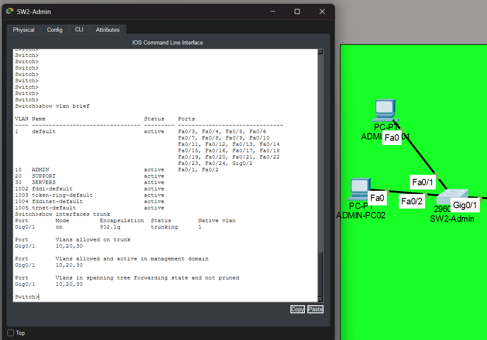
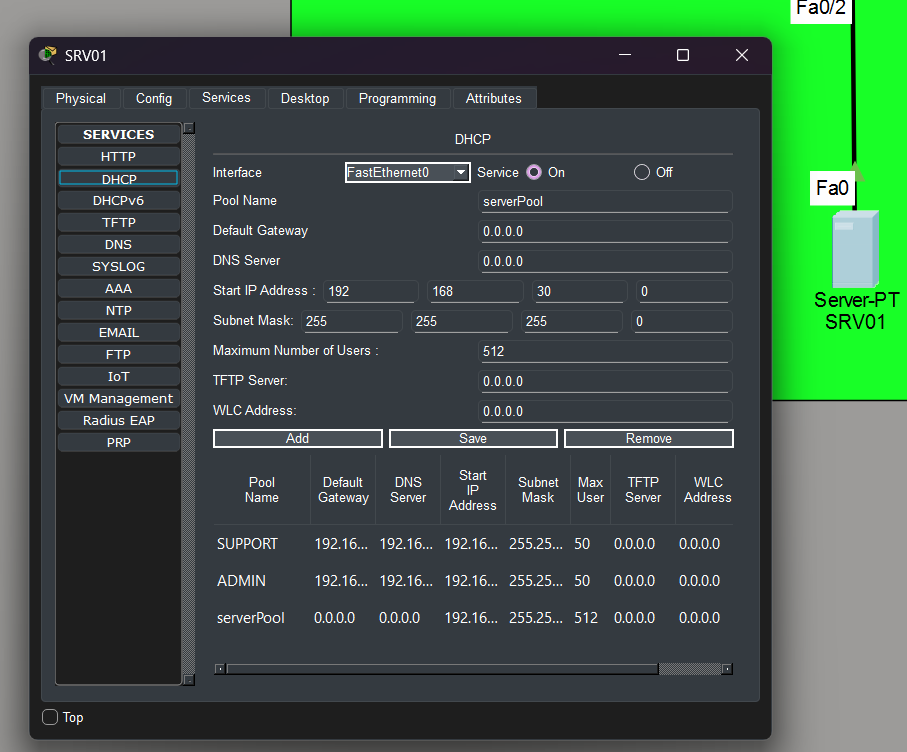
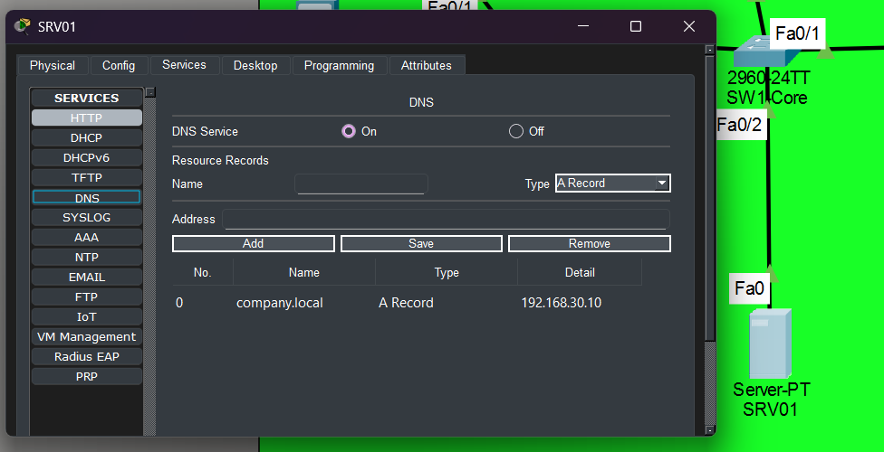
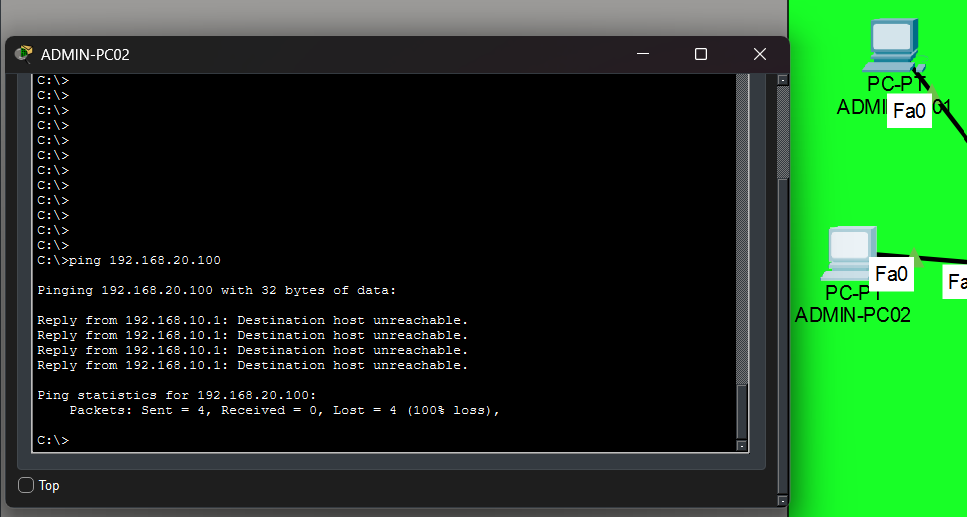
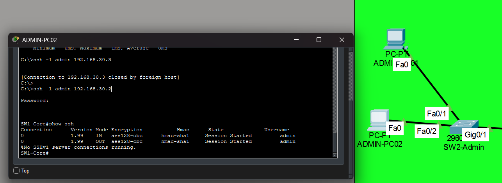
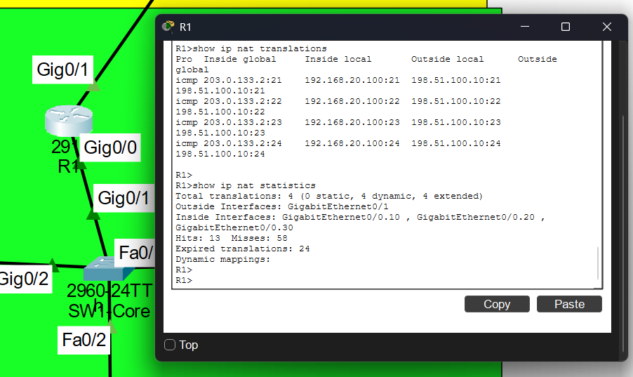
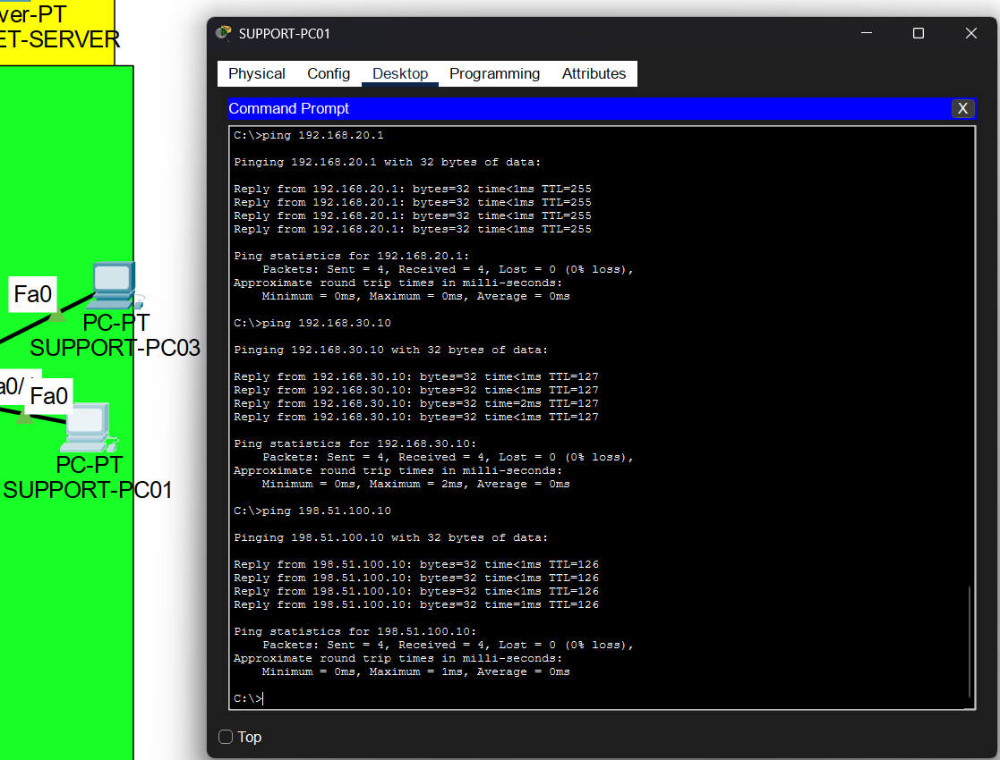
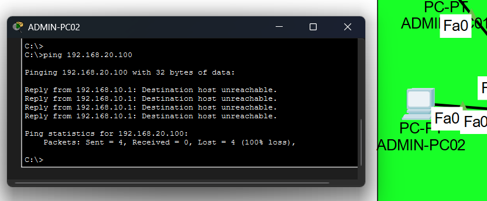

# Company Network Infrastructure Lab

## Overview
A simulated company network infrastructure built using Cisco Packet Tracer. The project demonstrates network configuration, segmentation, routing, network services, security and troubleshooting.

## Network Architecture
- Cisco 2911 routers
- Cisco 2960 switches
- Administration VLAN (VLAN 10)
- Technical Support VLAN (VLAN 20)
- Servers VLAN (VLAN 30)
- Simulated ISP and Internet server

## Implemented Technologies
- VLAN configuration and trunking
- Inter-VLAN Routing (Router-on-a-Stick)
- DHCP and DHCP Relay
- DNS configuration
- Access Control Lists (ACL)
- SSH remote device management
- Switch Port Security
- WAN configuration and NAT Overload
- Network troubleshooting using Cisco IOS commands

## Network Addressing

| Network | Subnet | Gateway |
|---|---|---|
| ADMIN | 192.168.10.0/24 | 192.168.10.1 |
| SUPPORT | 192.168.20.0/24 | 192.168.20.1 |
| SERVERS | 192.168.30.0/24 | 192.168.30.1 |

## Troubleshooting
Used commands such as:
- `ping`
- `ipconfig`
- `show ip interface brief`
- `show ip route`
- `show vlan brief`
- `show interfaces trunk`
- `show ip nat translations`

## Files
- `Georgian_AirLink_Network_Lab.pkt` — Cisco Packet Tracer project file.
- `screenshots/` — Network topology and configuration screenshots.

# Cisco Packet Tracer Enterprise Lab (VLANs, Routing, ACLs, NAT & SSH)
1. **Complete network topology**

## Addressing Overview

| Device / Segment | Interface / VLAN | IP Address / Subnet | Notes |
| :--- | :--- | :--- | :--- |
| **ADMIN** | `VLAN 10` | `192.168.10.0/24` (GW `192.168.10.1`) | Restricted from `SUPPORT` via ACL `110` |
| **SUPPORT** | `VLAN 20` | `192.168.20.0/24` (GW `192.168.20.1`) | Workstation segment |
| **SERVERS** | `VLAN 30` | `192.168.30.0/24` (GW `192.168.30.1`) | Internal server (`192.168.30.10`) and switch management |
| **R1 WAN / ISP-R1** | `Gi0/1` -> `ISP-R1` | `203.0.133.2` -> `203.0.133.1` | Default route and NAT overload (`PAT`) outside |
| **INTERNET-SERVER** | Simulated WAN | `198.51.100.10` | External reachability and NAT target |

## 2. VLAN Configuration

VLANs isolate broadcast domains across the network so administrative workstations, support workstations, and servers stay logically separated while still communicating through inter-VLAN routing on `R1`. Here, **VLAN 10** (`ADMIN`), **VLAN 20** (`SUPPORT`), and **VLAN 30** (`SERVERS`) are defined on the switches, with trunk links carrying tagged VLAN traffic between switches and `R1`.

<!-- Optional separate trunk capture:  -->

---

## 3. DHCP Configuration

DHCP automatically assigns IPv4 addresses, subnet masks, and default gateways to client devices in **ADMIN** (`VLAN 10`) and **SUPPORT** (`VLAN 20`) instead of requiring manual static setup on every workstation. Configuring separate pools with each VLAN's gateway (`192.168.10.1` and `192.168.20.1`) and starting host range ensures clients receive valid addresses for their segment.

---

## 4. DNS Configuration

The internal DNS service resolves friendly hostnames to IP addresses across the lab so devices can reach local services by name rather than memorizing numeric addresses. Enabling DNS and creating an `A` record mapping `company.local` to `192.168.30.10` verifies local name resolution.

---

## 5. Network Security (ACL)

Extended ACL `110` on `R1` controls inter-VLAN traffic between subnets so traffic isn't routed freely where it shouldn't go. Placing a deny rule from **ADMIN** (`192.168.10.0/24`) to **SUPPORT** (`192.168.20.0/24`) and testing with a ping proves the router actively blocks restricted cross-VLAN traffic.

---

## 6. SSH Remote Management

SSH provides encrypted command-line management over the network so administrators can configure and inspect network devices securely instead of using unencrypted Telnet or sitting directly at a console cable. Connecting from a PC to `SW1-Core` (`192.168.30.2`) and reaching the switch prompt confirms remote management access works.

---

## 7. NAT Configuration

NAT overload (`PAT`) translates private internal IP addresses (`192.168.10.0/24`, `192.168.20.0/24`, and `192.168.30.0/24`) to `R1`'s outside WAN IP (`203.0.133.2`) so internal hosts can communicate with external networks through the ISP router. Checking active translations and NAT statistics confirms that internal traffic is being dynamically translated and tracked.

---

## 8. Connectivity and Troubleshooting

End-to-end verification tests confirm that the full lab works together: reaching the default gateway and internal server (`VLAN 30`) validates local and inter-VLAN routing, pinging the simulated Internet server (`198.51.100.10`) validates NAT/WAN reachability, and a blocked cross-VLAN ping confirms ACL enforcement.

