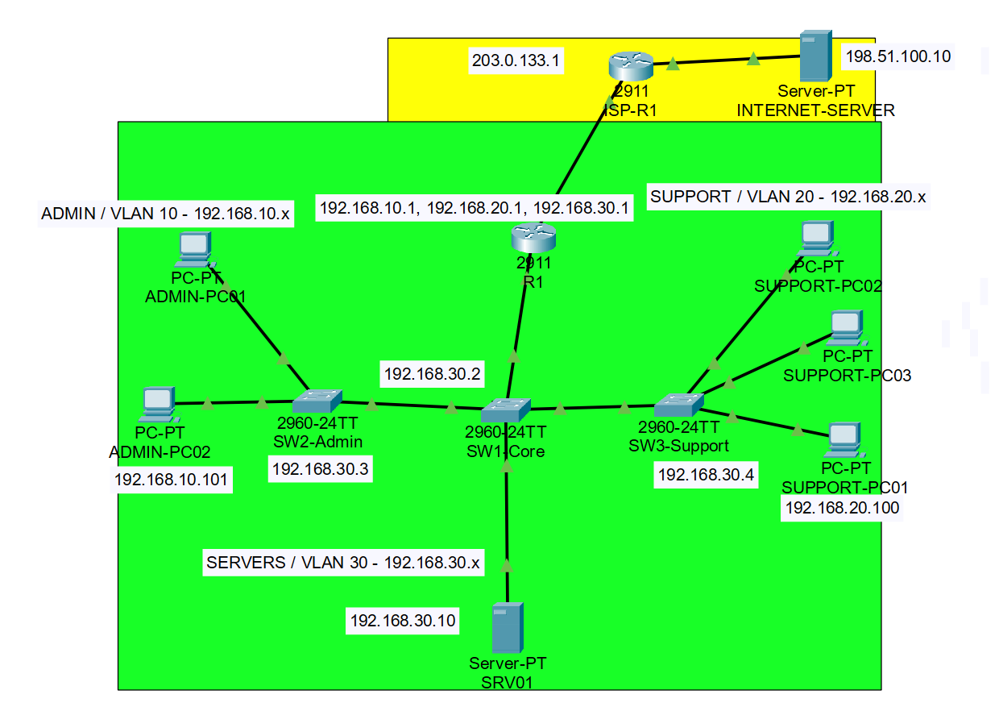
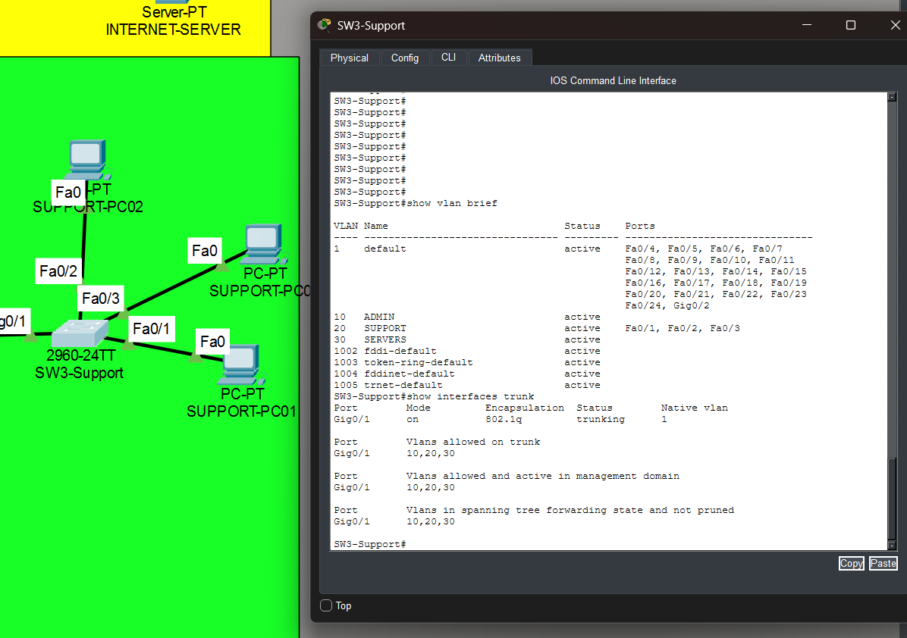
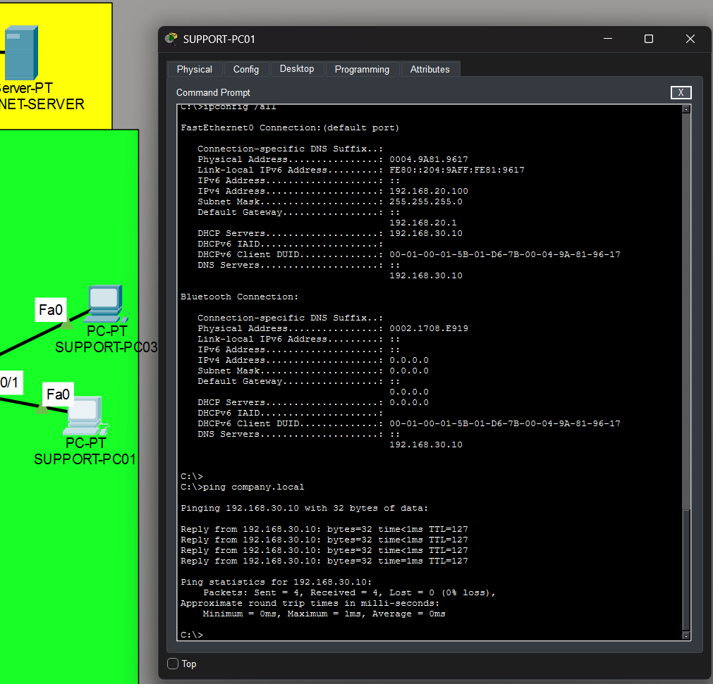
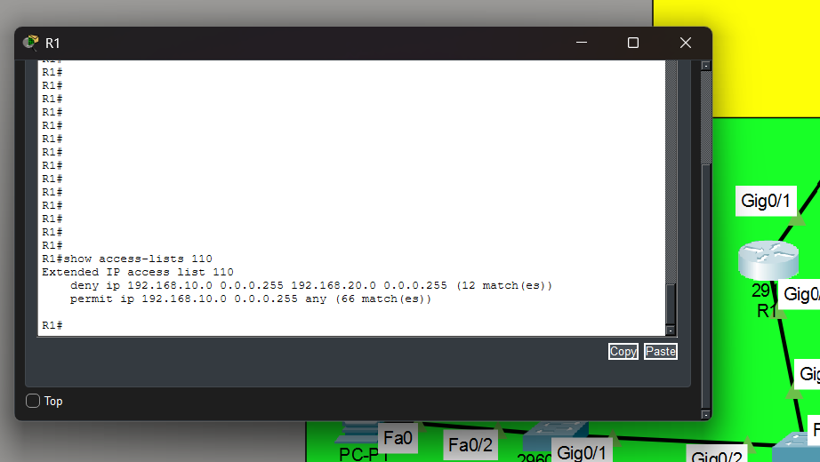
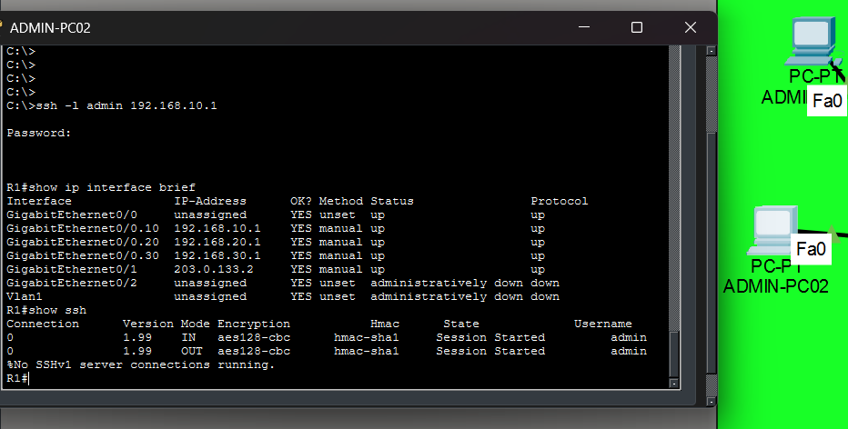
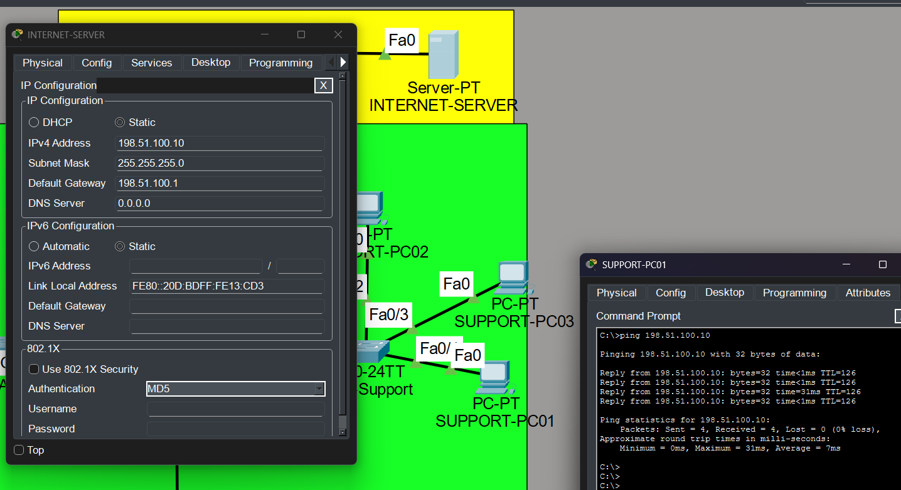

# Company Network Infrastructure Lab

## Overview
A simulated enterprise network infrastructure designed and implemented using Cisco Packet Tracer. This project demonstrates practical networking skills, including network segmentation, routing, network services, security configuration, remote device management, and troubleshooting.

## Network Architecture
The network consists of the following components:
- Cisco 2911 routers
- Cisco 2960 switches
- Administration Department (VLAN 10)
- Technical Support Department (VLAN 20)
- Servers Network (VLAN 30)
- Simulated ISP connection and external server

## Implemented Technologies

- VLAN creation and configuration
- IEEE 802.1Q trunking
- Inter-VLAN Routing (Router-on-a-Stick)
- DHCP configuration and DHCP Relay
- DNS configuration and hostname resolution
- Extended Access Control Lists (ACLs)
- SSH v2 remote device management
- Switch Port Security
- WAN connectivity and NAT Overload (PAT)
- Network monitoring and troubleshooting using Cisco IOS commands

# Cisco Packet Tracer Enterprise Lab (VLANs, Routing, ACLs, NAT & SSH)
## network topology

## IP Addressing Scheme

| Device / Segment | Interface / VLAN | IP Address / Subnet | Notes |
| :--- | :--- | :--- | :--- |
| **ADMIN** | `VLAN 10` | `192.168.10.0/24` (GW `192.168.10.1`) | Restricted from `SUPPORT` via ACL `110` |
| **SUPPORT** | `VLAN 20` | `192.168.20.0/24` (GW `192.168.20.1`) | Workstation segment |
| **SERVERS** | `VLAN 30` | `192.168.30.0/24` (GW `192.168.30.1`) | Internal server (`192.168.30.10`) and switch management |
| **R1 WAN / ISP-R1** | `Gi0/1` -> `ISP-R1` | `203.0.133.2` -> `203.0.133.1` | Default route and NAT overload (`PAT`) outside |
| **INTERNET-SERVER** | Simulated WAN | `198.51.100.10` | External reachability and NAT target |

## 2. VLAN Configuration

VLANs are used to logically segment the network into separate broadcast domains, isolating administrative workstations, technical support workstations, and servers. Communication between VLANs is handled by inter-VLAN routing configured on router R1 using the Router-on-a-Stick architecture.
Administration VLAN configuration:

Technical Support VLAN configuration:

Servers VLAN configuration:

<!-- Optional separate trunk capture:  -->

---

## 3. DHCP Configuration

DHCP automatically assigns IPv4 addresses, subnet masks, and default gateways to client devices in **ADMIN** (`VLAN 10`) and **SUPPORT** (`VLAN 20`) instead of requiring manual static setup on every workstation. Configuring separate pools with each VLAN's gateway (`192.168.10.1` and `192.168.20.1`) and DHCP pools are configured with the appropriate network addresses, subnet masks, default gateways, and DNS server settings to ensure clients receive valid network configurations.
DHCP configuration:

---

## 4. DNS Configuration

The internal DNS service resolves friendly hostnames to IP addresses across the lab so devices can reach local services by name rather than memorizing numeric addresses. Enabling DNS and creating an `A` record mapping `company.local` to `192.168.30.10` verifies local name resolution.
DNS server configuration:

Testing hostname resolution using the configured DNS record:

---

## 5. Network Security (ACL)

Extended ACL 110 is configured on router R1 to control traffic between VLANs. A deny rule blocks traffic originating from the ADMIN network (192.168.10.0/24) and destined for the SUPPORT network (192.168.20.0/24). Connectivity tests are performed to verify that the configured access restrictions are enforced.

Testing inter-VLAN access restrictions:

---

## 6. SSH Remote Management

SSH version 2 is configured to provide encrypted remote access to network devices. Local user authentication is enabled, and Telnet access is disabled on the VTY lines. Remote management is tested by establishing SSH connections from a workstation to the router and switches.
Testing SSH access to the router:

Testing SSH access to the switch:

---

## 7. NAT Configuration

NAT overload (`PAT`) translates private internal IP addresses (`192.168.10.0/24`, `192.168.20.0/24`, and `192.168.30.0/24`) to `R1`'s outside WAN IP (`203.0.133.2`) NAT Overload (PAT) is configured on router R1 to translate private internal IP addresses into the router's public-facing WAN address (203.0.133.2). This allows devices from the internal VLANs to communicate with external networks through the simulated ISP connection. NAT translations are verified using Cisco IOS show commands.
NAT configuration:

Verifying NAT translations and connectivity to the simulated Internet server:

---

## 8. Connectivity and Troubleshooting

End-to-end verification tests confirm that the full lab works together: reaching the default gateway and internal server (`VLAN 30`) validates local and inter-VLAN routing, pinging the simulated Internet server (`198.51.100.10`) validates NAT/WAN reachability, and a blocked cross-VLAN ping confirms ACL enforcement.

Connectivity and troubleshooting tests are performed to verify communication between network devices and validate the implemented security policies.

The following tests are conducted:
- Successful connectivity to the default gateway.
- Successful communication with the internal server in VLAN 30.
- Successful connectivity to the simulated Internet server (198.51.100.10).
- Verification of ACL enforcement through an intentionally blocked ping from ADMIN to SUPPORT.
These tests demonstrate the functionality of inter-VLAN routing, internal network services, NAT/PAT, and access control policies.

## Files
- `Georgian_AirLink_Network_Lab.pkt` — Cisco Packet Tracer project file.
- `screenshots/` — Network topology and configuration screenshots.
